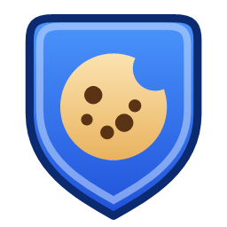
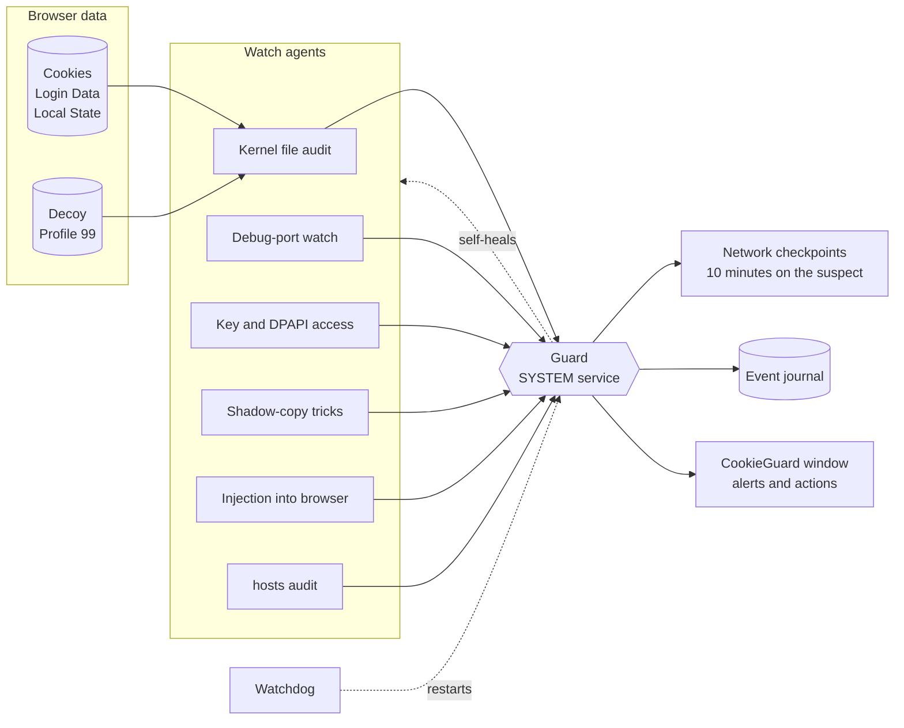

<div align="center">



# CookieGuard

**Security suite for Windows that protects what infostealers actually steal: your browser sessions and passwords.**

Real-time guard · 8 independent watch agents · decoy profiles · network checkpoints · 70-engine file check · own ad blocker

[](https://github.com/SpawRon/CookieGuard/releases/latest)
[](https://github.com/SpawRon/CookieGuard/releases)
[](#install)
[](LICENSE)
[](https://github.com/SpawRon/CookieGuard/commits/main)

[**Download**](https://github.com/SpawRon/CookieGuard/releases/latest) · [Features](#what-it-does) · [Compared to classic AV](#cookieguard-vs-a-classic-antivirus) · [How it works](#how-it-works) · [FAQ](#faq) · [**Русский**](README.ru.md)

</div>

---

Modern account theft doesn't need a virus your antivirus knows. A stealer reads the
browser's cookie database, or starts Chrome with a debug port and asks it for decrypted
cookies, then posts the archive to a Telegram bot. It's done in seconds, and nothing
"malicious" ever touches the disk.

CookieGuard covers the jobs you expect from an antivirus: scanning files, a real-time
guard, quarantine and web filtering. On top of that it watches every way into your cookies
and passwords. It doesn't just answer "is this file known to be bad?". It answers
**who touched your cookies, how, when, and where the data went next**.

## What it does

| | |
|---|---|
| 🛡️ **Real-time guard** | Runs as SYSTEM from boot, without a window, even before anyone signs in. A separate watchdog restarts it within a minute if it gets killed. |
| 🍪 **Cookie & password audit** | The Windows kernel logs every process that opens `Cookies`, `Login Data`, `Local State` or `key4.db`, for every profile of every browser. You see the program, PID, command line and exact time. |
| 🕵️ **8 watch agents** | File audit, decoy profiles, debug-port detection, encryption-key access, shadow-copy tricks, DLL injection into browsers, exfil network, `hosts`. Each one checks in, and silence counts as an alarm. |
| 🪤 **Decoy profiles** | A fake `Profile 99` in every browser. Browsers never open it; a stealer looping over profiles does, and gets caught red-handed. |
| 🌐 **Network checkpoints** | 10 checks per connection: signature, publisher, folder, DNS name, `hosts` spoofing, exfil channels (Telegram API, Discord webhooks, file drops), proxy, file age, VirusTotal, trust. |
| 🔎 **File & archive check** | Drop a file, folder or archive on the window. It unpacks archives, including nested and password-protected ones, then checks them against **~70 engines** via VirusTotal. Only the SHA-256 hash leaves your PC, never the file. |
| 🧭 **System baseline** | Snapshots ~200 persistence points (autoruns, extensions, certificates, proxy, services, AV exclusions) and shows exactly what changed since your system was clean. |
| 🧰 **Fix all, with undo** | One checklist for every fixable finding. Every change is reversible from `undo\`. |
| 🔒 **Quarantine & kill** | Byte-for-byte reversible quarantine, process termination and neutralization, with an optional auto-quarantine for files with 5+ detections. |
| 🚫 **Own ad blocker** | Extension for Chrome, Edge and Brave. Choose EasyList, EasyPrivacy, AdGuard, Fanboy, or add your own list URL. It updates itself and never touches the network. |
| 🧱 **Safe DNS** | One click switches to a filtering DNS (malware, phishing, ads) and back. |
| ♻️ **Self-healing** | Every protection part is checked once a minute and switched back on if anything turned it off, and that change itself becomes an alert. |

## CookieGuard vs a classic antivirus

| | Classic antivirus | **CookieGuard** |
|---|:---:|:---:|
| Check files against known malware | own engine | ✅ ~70 engines via VirusTotal, hash only |
| Real-time background guard | ✅ | ✅ SYSTEM service + watchdog |
| Quarantine | ✅ | ✅ reversible, byte for byte |
| Web filtering / ad blocking | paid add-on | ✅ built in, your choice of lists |
| **Shows which program opened your cookie database** | — | ✅ kernel audit, with command line |
| **Catches debug-port cookie theft (Chrome 127+ bypass)** | rarely | ✅ |
| **Decoy browser profiles** | — | ✅ |
| **Sees cookies leaving via Telegram, Discord or file drops** | — | ✅ |
| **Explains every root certificate and whether it can read HTTPS** | — | ✅ |
| **Checks browser extensions against the store** | — | ✅ |
| **Diffs your whole system against a known-good baseline** | — | ✅ |
| **Line-by-line `hosts` changes, with who made them** | partial | ✅ |
| Uploads your files to the vendor's cloud | often | **never** |
| Rules you can read | closed signatures | ✅ plain-text rules in `lib\` |
| Price | subscription | **free, MIT** |

**Rules, not signatures.** A signature only catches malware someone has already seen. CookieGuard's
rules describe *behaviour*: "a program that isn't a browser opened the cookie database", "a browser
was started with a remote debugging port", "an unsigned process just connected to the Telegram API".
Brand-new malware has to do one of these things to steal anything, so it gets caught too.

It works alongside the antivirus you already have (Defender, ESET, Kaspersky and others) and
never fights it.

## Install

1. Download the [latest release](https://github.com/SpawRon/CookieGuard/releases/latest) (or **Code → Download ZIP**) and unpack it.
2. Run **`Setup.cmd`** and accept the administrator prompt.
3. Start CookieGuard from the Start menu, go to **Protection** and turn on **Auto-protection**.

That's all. The installer puts the app into `C:\Program Files\CookieGuard`, where an unprivileged
process can't tamper with it, and keeps its data in an admin-only `C:\ProgramData\CookieGuard`.

**Requirements:** Windows 10 or 11, built-in PowerShell 5.1 and .NET Framework 4.x. Nothing else
to install, and no third-party binaries.

**Portable mode:** unpack anywhere and run `CookieGuard.exe`. All data stays next to the app.

**Update:** **Protection → Program version → Update**. It pulls `main` from this repository over
HTTPS, never runs anything from the download, and never touches your data. The ad-blocker
extension updates itself after the app does.

**Uninstall:** *Settings → Apps → CookieGuard*, or `scripts\Uninstall.ps1`. Evidence and logs are
kept unless you add `-RemoveData`.

## How it works



* The guard reads the Windows Security log (events 4656/4663 for file access and 4688 for process
  launches). These records come from the kernel, so a normal program can't forge or hide them.
* A program that touched cookies stays under network watch for 10 minutes. Every new connection is
  logged with its address, DNS name and owner.
* Every agent checks in to `state\agents.json`. The watchdog, a separate process, compares the
  check-ins and restarts the guard if an agent goes silent.
* Alerts are written to `logs\events-YYYY-MM.jsonl`, so they survive restarts, reboots and
  updates.

The full manual, with every part, what it sees and where its limits are, is in
[`docs/GUIDE.ru.md`](docs/GUIDE.ru.md) (Russian).

## Privacy

CookieGuard **never reads the contents** of your cookies or passwords. It only records who
touches them. Nothing is sent anywhere unless you press a button for it:

* **VirusTotal**: only the SHA-256 hash, never the file.
* **Extension store check**: only the extension ID.
* **Ask an AI**: prepares a text with the evidence and puts it on your clipboard. You decide where to paste it.

The ad blocker has no `webRequest`, `cookies` or `history` permission, and its CSP forbids any
network access. The browser itself applies the block rules.

## FAQ

<details>
<summary><b>Will it conflict with my antivirus?</b></summary>

No. It detects ESET, Kaspersky, Defender and others, and doesn't raise "protection off" alarms when
another AV is the active one. It never disables or replaces anything.
</details>

<details>
<summary><b>Why PowerShell and not a compiled app?</b></summary>

Every rule and check is plain text that you can read in `lib\`. A security tool that asks for admin
rights should be auditable. The only native part is the 60 KB launcher, and its C# source is in
`build\Launcher.cs`. Helper types are compiled once on your own machine and cached in `cache\`.
</details>

<details>
<summary><b>Why is the ad blocker installed via "Load unpacked"?</b></summary>

Chrome, Edge and Brave don't let any program install an unpacked extension silently. That rule is
browser protection, and CookieGuard won't bypass it. The app opens the extensions page and copies
the folder path for you, so it takes three clicks, once. After that, the extension updates
itself whenever the app does.
</details>

<details>
<summary><b>Some ads still get through. What can I do?</b></summary>

Open **Protection → Ad blocker → ⋯ → Choose filter lists** and add *AdGuard Base* or *AdGuard
Russian*, plus *Fanboy's Annoyance* for pop-ups and cookie banners. You can also add any list in
Adblock format by URL. In the extension's own settings you can block a domain or hide an element
yourself.
</details>

<details>
<summary><b>My cookies were already stolen. What now?</b></summary>

See [*If the theft already happened*](docs/GUIDE.ru.md#если-кража-уже-случилась). In short: sign out
of all sessions in every important account (that kills the stolen cookies), change passwords from a
clean device, then run **Scan system** and **Fix all**.
</details>

## Project layout

```
CookieGuard.ps1   main window          scripts\   guard, watchdog, install/uninstall
CookieGuard.exe   launcher (C#)        lib\       checks, agents, monitor, network, UI
Setup.cmd         installer            adblock\   browser extension (MV3)
docs\             manual, images       build\     launcher source, icon generator
```

## License

[MIT](LICENSE). Use it, change it, share it. Found a bug or a stealer trick CookieGuard misses?
[Open an issue](https://github.com/SpawRon/CookieGuard/issues/new/choose).
